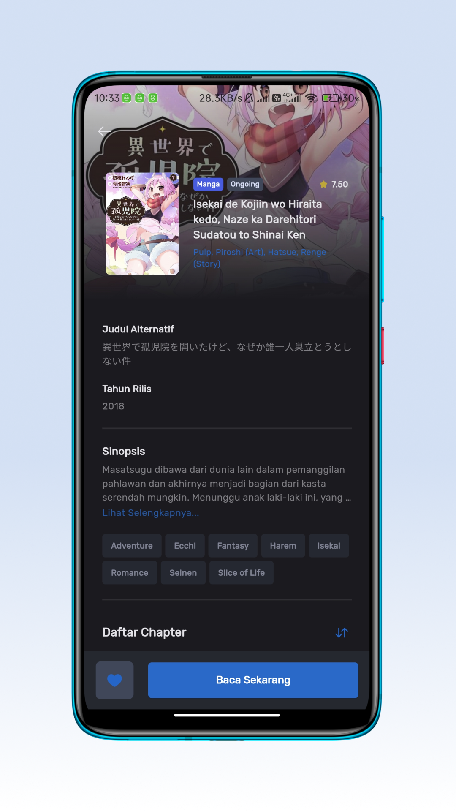
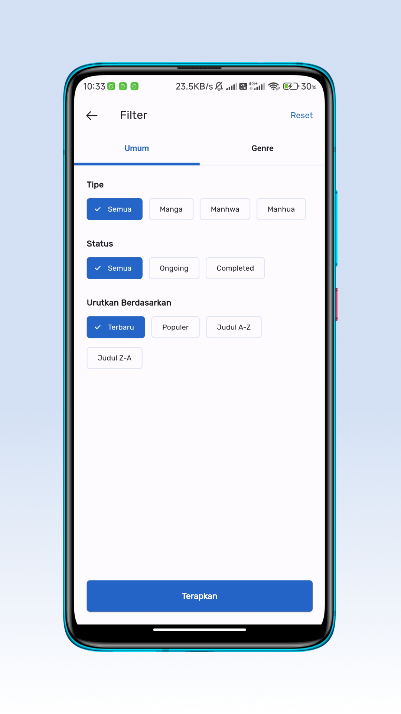
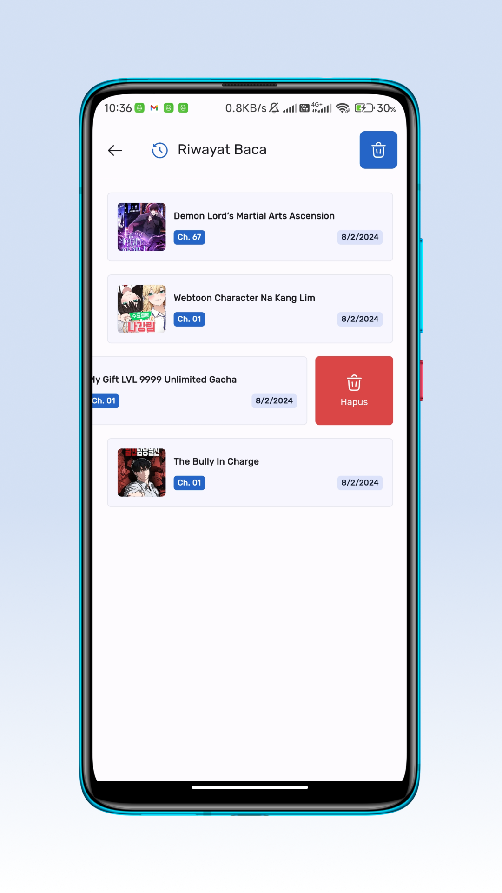
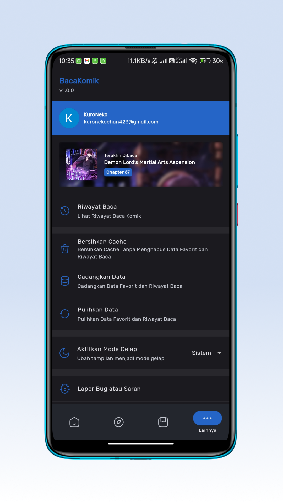

# BacaKomik App

Read Comic Application created using Flutter.

## Documentation

- [Architecture](docs/ARCHITECTURE.md): structure, layers, storage and compatibility rules.
- [Contributing](docs/CONTRIBUTION.md): setup, build, conventions, testing and PR checklist.

## Screenshot

     
