# BacaKomik

An Android reader for manga, manhwa and manhua from several sources. Each source is a small JavaScript extension the app installs from an extension repo, so new sites can be added without an app update. Browse and search comics, read chapters online or download them to read offline, and keep a personal library of bookmarks, categories and reading history. The library lives on the device; you can export it to a backup file or, optionally, sync it across devices through your own Google Drive.

## Download

Get the APK from the [Releases](https://github.com/sofyan-rs/bacakomik-app-flutter/releases) page; `arm64-v8a` fits almost every phone. Android 7.0 or newer. The app checks for new releases and updates itself. More on the [website](https://bacakomik.kurodev.org).

## Screenshots

| Splash | Home | Sources | Explore |
|---|---|---|---|
| 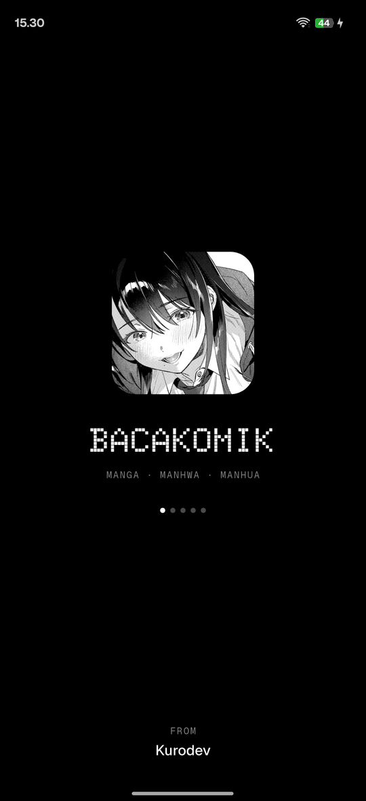 | 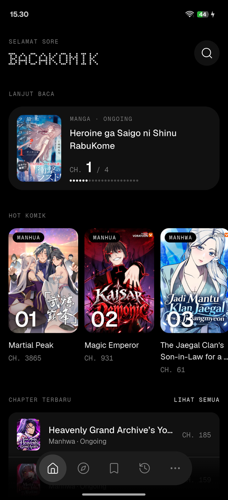 | 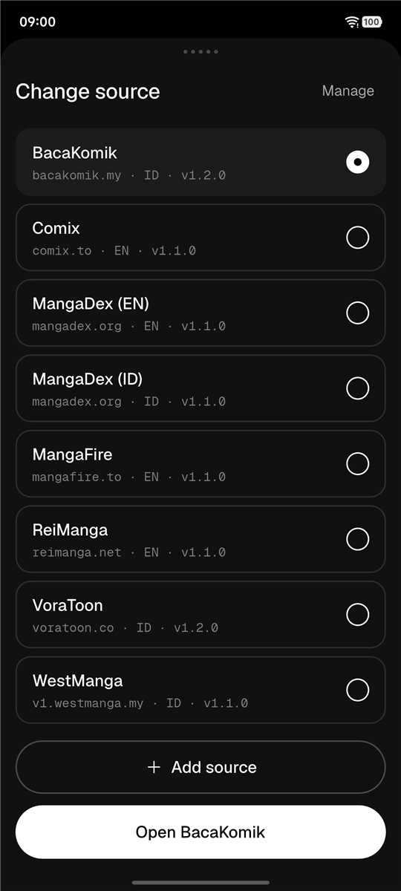 | 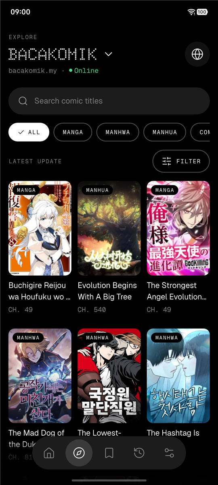 |

| Filter | Detail | Reader | Bookmarks |
|---|---|---|---|
| 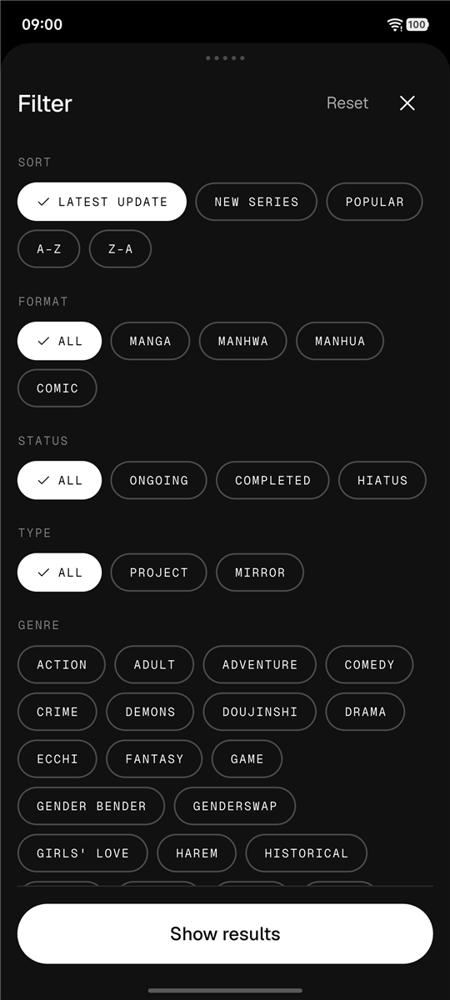 | 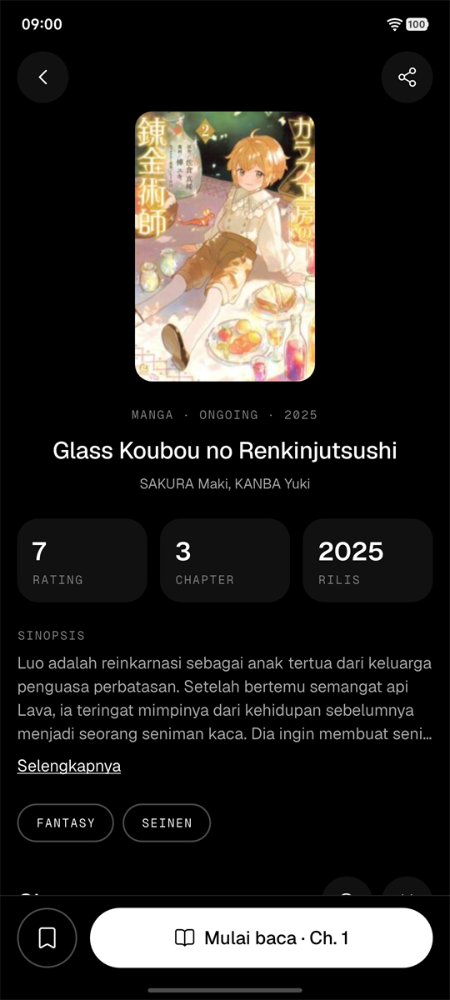 | 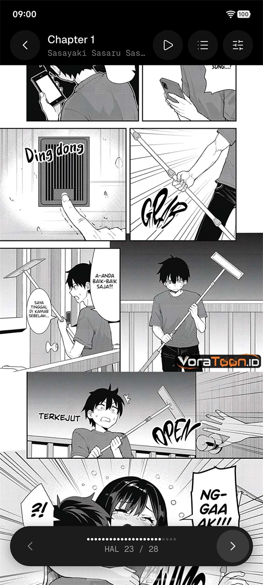 | 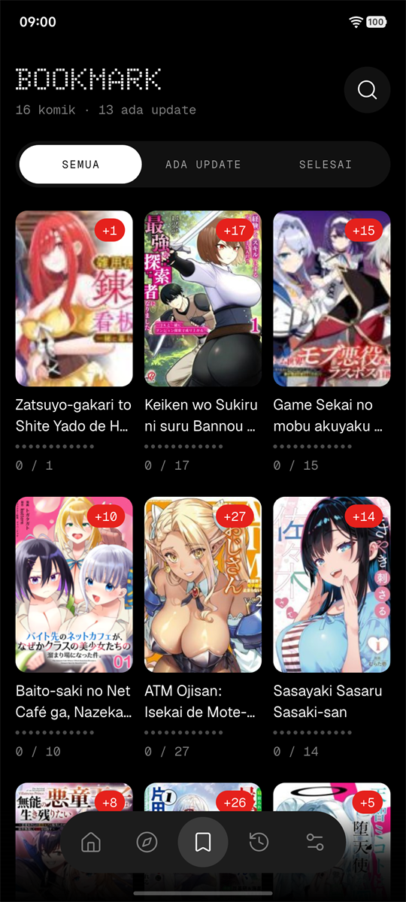 |

| History | Extensions | Import from Mihon | More |
|---|---|---|---|
| 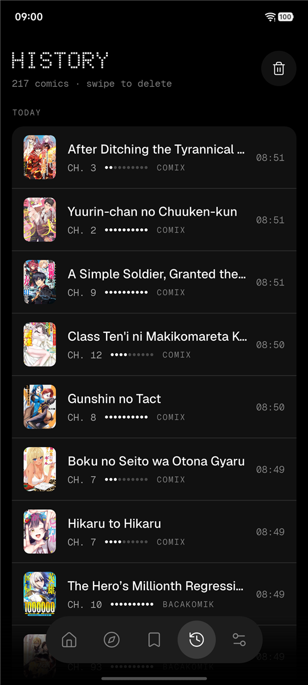 | 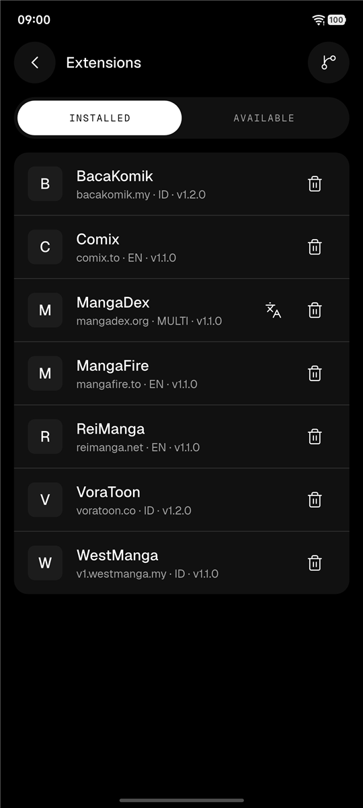 | 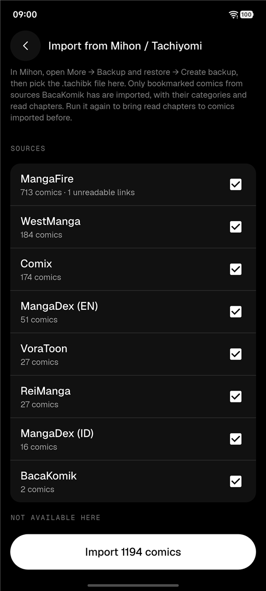 | 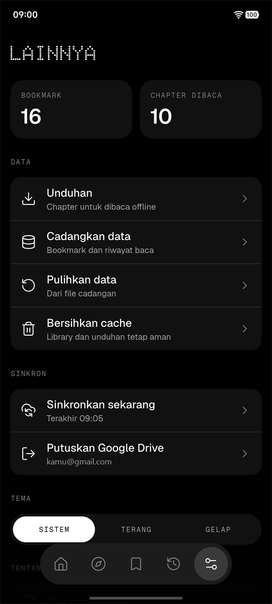 |

| Download chapters | Downloads | Light theme |
|---|---|---|
| 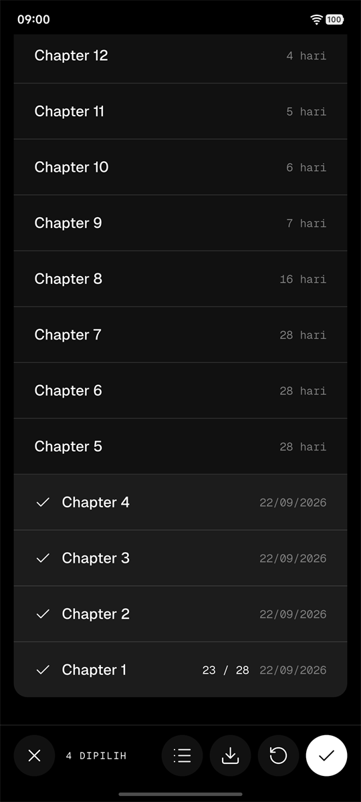 | 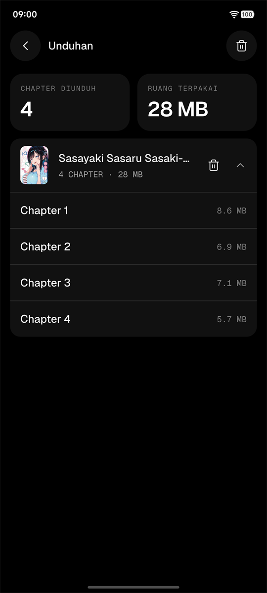 | 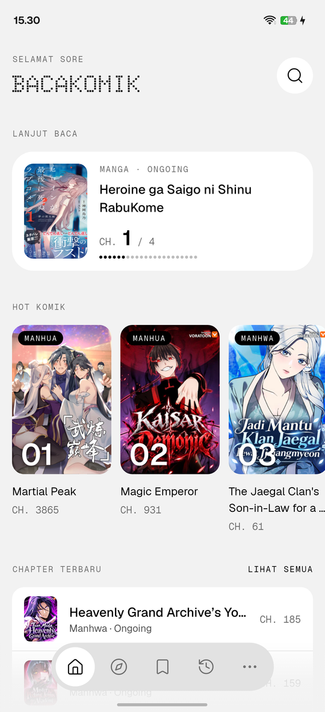 |

Screenshots were taken on a real device (iQOO I2218, Android 16) running v2.0.0.

## Features

- **Sources:** pick the source in the header of Home or Explore. Two sources come bundled; more install from More → Extensions. A multi-language source becomes one source per enabled language (for example EN and ID), each with its own bookmarks and history. Installed extensions show an update badge when the repo has a newer version.
- **Home:** continue reading with chapter progress, new series and the latest updates of the current source. Pull to refresh for a small easter egg.
- **Explore:** title search combined with the source's own filters (type, status, sort, genres…), with infinite scroll.
- **Comic details:** alternative titles (other languages and romanized names; tap to see them all), source and language, rating, chapter count, release year, synopsis and genres. The chapter list can be searched and sorted, marks new, read, partly read (`5 / 24`) and downloaded chapters, and supports selecting chapters to download them or mark them read or unread. Share a comic as a link that opens the app, save its cover, or long-press the title to copy it. Without a connection, comics you downloaded, bookmarked or read still open from the details saved on the phone.
- **Cloudflare checks:** when a site asks for a bot check, open it in the built-in WebView, pass it, and the app reuses its cookies. The WebView menu can refresh, share the link, open it in the browser and clear cookies. Sites that only answer a real browser are read through a hidden WebView, without any action.
- **Reader:** vertical strip or page by page (right-to-left or left-to-right), fit to width or height, keep the screen on, optional gap between pages. Double-tap or pinch to zoom, and move the zoomed page in any direction; page meter, previous/next chapter, and a "chapter finished" card. Reopens a chapter at the page you stopped at. Auto-scroll with adjustable speed in the vertical reader. Downloaded chapters open from the phone. Long press a page to save it to the gallery.
- **Bookmarks:** language badge and unread-chapter badge on each card, read progress and search by title or alternative title across every tab (tab counts show the matches). Swipe the comics sideways to change tab. Group them by status, source or your own categories (a comic can be in several); pick a category when you bookmark, or skip. Pull to refresh checks the comics on screen (the open group, narrowed by a search) for new chapters, with a progress notification; stop it from the notification's Cancel button or the stop button in the header. A comic that takes too long is skipped.
- **History:** last read chapter per comic, grouped by day; swipe to delete.
- **Downloads:** download chapters for offline reading. Downloads keep going in the background and while the phone is locked, with a progress notification. More → Downloads shows the storage used, the queue with retry and cancel, and downloads grouped per comic. Files stay in the app's own storage and are removed when the app is uninstalled.
- **Migration:** in More → Backup & sync → Migration. Move bookmarks and reading history to another source, one comic, a selection or a whole source: each title is searched in the new source (and, if nothing comes up, its alternative titles), matches by title or alternative title are picked for you and you choose the rest. Import your library from a Mihon / Tachiyomi backup (`.tachibk`: bookmarks from sources BacaKomik has, with their categories and read chapters) or from a site's CSV export of your list (titles are searched in that site's source, one at a time). Imported comics load their covers and chapters when you open them or refresh, and the chapters you had read are marked read then. A series you already bookmarked from another source is not added twice.
- **Sync:** turn on Google Drive sync in More to sync bookmarks, categories and reading history across devices. The library is kept as one file in the app's hidden Drive folder (`drive.appdata`), so the app cannot see your other Drive files. Nothing goes through our servers.
- **Data:** back up and restore the library to a file, clear cached chapter pages (covers and downloads are kept), and choose the system, light or dark theme.

## Extensions

The app reads extensions from this repo by default:

```
https://bacakomik-ext.kurodev.org/index.json
```

A second repo is built from the public extension source (its extensions differ from the default repo's):

```
https://sofyan-rs.github.io/bacakomik-ext-public-source/index.json
```

Add a repo in More → Extensions → Extension repos. Extensions run code and access the internet, so only add repos you trust.

**Want to make your own extension?** Start from [sofyan-rs/bacakomik-ext-public-source](https://github.com/sofyan-rs/bacakomik-ext-public-source): it has example extensions, the extension contract, and guides to write, test and publish one. Host the built `index.json` anywhere and add its URL as a repo in the app.

Some extensions are reimplemented from the Tachiyomi / Mihon extensions in [keiyoushi/extensions-source](https://github.com/keiyoushi/extensions-source) (Apache License 2.0); each one credits its source in its file.

## Requirements

- Android 7.0+ (API 24)
- To build: Flutter (stable, Dart 3.13), JDK 17, Android SDK 37

## Build

```bash
flutter pub get
dart run build_runner build -d   # regenerate freezed / json / injectable / assets code
flutter run                      # debug build on a connected device
flutter analyze
flutter test
```

Release signing and testing extensions locally are described in [Contributing](docs/CONTRIBUTION.md).

## Docs

- [Architecture](docs/ARCHITECTURE.md): structure, layers, sources and extensions, storage, Dotline UI rules
- [Contributing](docs/CONTRIBUTION.md): setup, build, conventions, testing, PR checklist
- [Link hosting](hosting/README.md): Cloudflare Worker for shared links, the website and the privacy policy

## Credits

- [Mihon](https://github.com/mihonapp/mihon) (Apache License 2.0), the successor of Tachiyomi: BacaKomik uses it as a reference for features and behavior, such as extensions and extension repos, the library and categories, the reader, migration and the `.tachibk` backup format read by the Mihon import.
- [keiyoushi/extensions-source](https://github.com/keiyoushi/extensions-source) (Apache License 2.0): reference for some extensions (see [Extensions](#extensions)).

## Disclaimer

BacaKomik is not affiliated with any of the sites it reads from, and it does not host, store or distribute any comics. Like a web browser, it only shows content that is already freely available on those sites. Copyright and DMCA takedown requests should go to the owners of the site that hosts the content.

## License

BacaKomik is free software under the [GNU General Public License v3.0](LICENSE): you can use, study, change and share it, and apps built from it must stay open source under the same license.

Extensions are a separate project under the Apache License 2.0 ([public source](https://github.com/sofyan-rs/bacakomik-ext-public-source)). Third-party assets keep their own licenses: the Geist, Geist Mono and Doto fonts (SIL Open Font License 1.1), Lucide icons (ISC). The splash artwork and the "kuru kururin" animation and sound belong to their respective owners and are not covered by this license. Comics shown in the app and the screenshots belong to their publishers.

Found a bug or have an idea? [Open an issue](https://github.com/sofyan-rs/bacakomik-app-flutter/issues/new).
